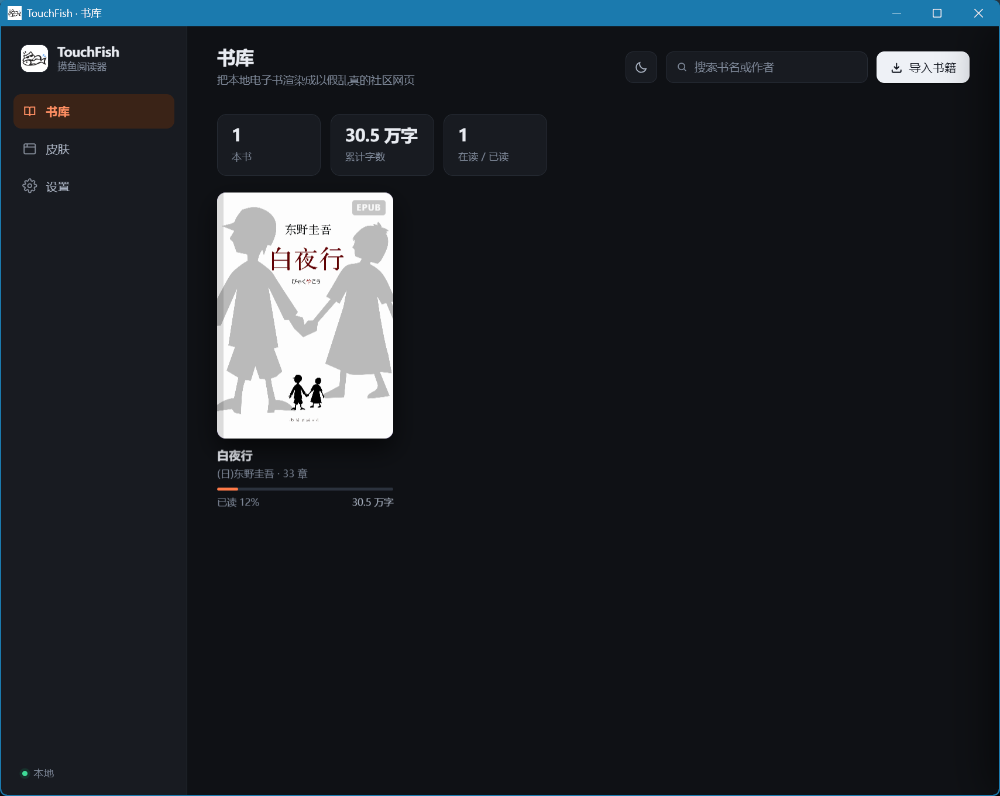
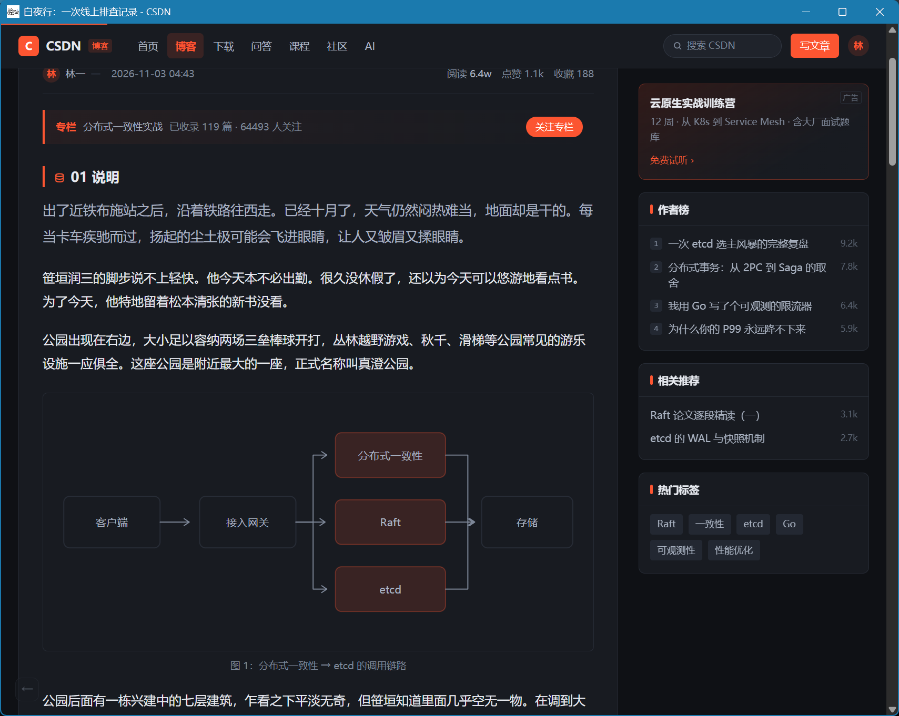
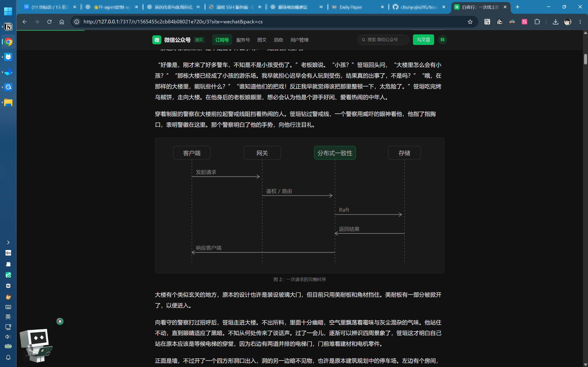

<p align="center"></p>

# TouchFish

把本地电子书渲染成"以假乱真"的社区网页——同一份书籍内容，装进本来就该长这样的壳里。

**v0.7**：Rust 后端 + 两种前端形态（原生窗口 / 普通网页）+ 书库界面。EPUB / MOBI / TXT 解析已打通，13 套站点皮肤、8 个行业主题包、3 种版式全部接入。

<p align="center"></p>

<p align="center"></p>

<p align="center"></p>

## 两种打开方式

同一套界面、同一份数据，两种前端形态，随时可以换：

| | 独立窗口（默认） | 网页模式 |
|---|---|---|
| 怎么开 | 双击 `touchfish.exe`，或 `cargo run` | 托盘右键「打开网页页面」，或书库设置里「在浏览器中打开」 |
| 长相 | 无地址栏、无标签页的原生窗口 | 就是一张普通网页 |
| 依赖 | Windows 需 WebView2 运行时（Win10/11 自带）；Linux 走 WebKitGTK | 只要有个浏览器，什么都不用装 |
| 窗口标题 | 跟随页面标题，和浏览器标签一致 | 由浏览器标签决定 |
| Esc（Boss Key） | **收起窗口**，进程留着，热键一按就回来 | 跳转到 `boss_url`（默认 `about:blank`） |
| 唤出 | `Ctrl+Alt+F` 全局热键 + 通知区托盘 | 切标签页就行；退出在「设置 → 退出 TouchFish」 |
| 适合 | 日常使用：最像"一个正在看的页面"，Alt+Tab 里也干净 | 调试（DevTools 随便开）、多标签对照、没装 WebView2 的机器 |

两种模式共用同一个进程内服务和同一个数据目录（`%APPDATA%\TouchFish`），所以书库、进度、设置完全一致；区别只是"谁来显示这张网页"。

同一个端口只能有一个实例。窗口已经开着时再点「在浏览器中打开」（或再双击一次启动脚本），会复用已有实例、只把浏览器叫起来，不会起第二个进程。确实需要两个互不干扰的服务再换端口：

```bash
TF_PORT=7318 ./touchfish.exe --server --open
```

## 跑起来

```bash
cargo run                     # 直接开一个原生窗口（推荐）
cargo run -- --server         # 只起本地服务，用浏览器打开 http://127.0.0.1:7317/
cargo run -- --server --open  # 起服务并自动开浏览器
cargo run --release           # 正式版，单文件，双击即可
cargo test                    # 解析层的单元测试（MOBI 解压、UTF-8 跨记录）
```

网页版不用碰命令行：托盘右键「打开网页页面」，或书库设置里的「在浏览器中打开」。两者都走同一条路径——先把窗口收起来，再用系统浏览器打开同一个地址，书、进度、设置和窗口里完全一致。退出在网页的「设置 → 退出 TouchFish」。

改 `assets/` 里的 CSS / HTML 时用 `TOUCHFISH_DEV=1 cargo run`（直接从磁盘读资源）；否则资源是编译期用 `include_dir!` 嵌进二进制的，只改样式不重新编译是看不到变化的。另外同一端口已有实例时新进程会复用旧进程，改完代码界面没变先把托盘里的 TouchFish 退出再启动。

打包发给别人：

版本号只有一个地方要改：`scripts/version.txt`。它会被 `include_str!` 在编译期嵌进可执行文件（启动横幅、`/api/settings` 的 `version` 字段），打包脚本也直接读它决定压缩包名字。`Cargo.toml` 里的 `version` 只是 crate 元数据，跟对外版本无关。

Windows 直接双击 `scripts\package.bat`——会跑 `cargo build --release`，把 exe、README 和样书收进 `dist\TouchFish-<版本>-win64.zip`，不需要 Git Bash 或 Python：

```bat
scripts\package.bat               :: 编译 release 并打包
scripts\package.bat --no-build    :: 复用已有产物，只重新打包
scripts\package.bat --clean       :: 打包前清掉 dist\
```

Linux / macOS（或 Git Bash）用 shell 版：

```bash
scripts/package.sh              # 编译 release 并压成 dist/TouchFish-<版本>-win64.zip
scripts/package.sh --no-build   # 复用已有产物，只重新打包
```

首次导入：把 `.epub` / `.mobi` / `.txt` 拖进窗口，或点右上角「导入书籍」。

窗口模式下的行为细节：

- 关闭窗口（X）= **收起到托盘**，进程和本地服务继续跑；真退出只走托盘右键菜单的「退出」
- **Esc（Boss Key）= 同样只是把窗口收起来**：任务栏和 Alt+Tab 里都看不到，页面停在原处
- **`Ctrl+Alt+F` = 全局热键，在任意程序里按都能把窗口拎回前台**（窗口已在前台时按则收起）
- 通知区托盘图标：左键切换显示/收起；右键菜单三项——「打开主页面」「打开网页页面」「退出」（`TOUCHFISH_TRAY=0` 关掉）
- 「打开网页页面」会先把窗口收起来，再用系统浏览器打开同一个地址，两种前端同一时刻只露一个；浏览器标签需要自己关，程序管不到它
- 同一端口上已有实例时，第二次启动会复用，不会报"端口被占用"

热键被别的软件占用、托盘又被关掉时，X 与 Esc 会退回"直接退出"，并在控制台打一行警告——不会出现窗口收起来却叫不回来的情况。

## 快捷键

阅读页（伪装页面本身，按 `?` 会弹出提示面板）：

| 键 | 作用 |
|---|---|
| `Esc` | 立即离开：桌面版收起窗口，浏览器版跳 `boss_url`。**不受下面的开关影响，永远生效** |
| `←` `→` | 上一页 / 下一页。有文章分页时先翻页，翻到头自动跨章 |
| `S` / `Shift+S` | 换下一个 / 上一个站点皮肤（13 个循环） |
| `P` / `Shift+P` | 换下一个 / 上一个主题包（8 个循环） |
| `D` | 深色 / 浅色切换（同时写进设置，回书库也是同一外观） |
| `+` `-` | 正文调大 / 调小（13–24px），记在 localStorage 里 |
| `H` | 回书库 |
| `?` | 弹出 / 收起快捷键面板 |

书库界面：`/` 聚焦搜索，`Ctrl+O` 导入，`Esc` 关闭抽屉或清空搜索。

阅读页上还有四个**看得见**的回书库入口，都不需要记快捷键：顶栏 logo、面包屑第一项「首页」、顶栏右侧头像、左下角的半透明 `←`。前三个是真实站点本来就有、点了会回首页的位置，最后一个是兜底——伪装页里没人会注意到这么个 30px 的小方块。

设置里可以整体关掉"阅读页快捷键"——关掉后只保留 `Esc`，其余按键交还给浏览器（比如你习惯用它翻页或调试）。组合键（`Ctrl` / `Alt` / `Cmd` 开头）永远不抢，输入框里也不抢。

数据目录（书、封面、进度、设置都在这里，删掉即彻底卸载）：

- Windows：`%APPDATA%\TouchFish`
- Linux：`~/.local/share/touch-fish`
- 设置里可以改：填一个**空目录的绝对路径**，会把书、封面、进度、设置、自定义图标复制过去并立即切换，旧目录里的数据随后清理；`webview` 缓存不搬（可重建）
- 新位置记在数据目录之外的指针文件里：Windows `%APPDATA%\TouchFish-location.json`，Linux `~/.config/touch-fish/location.json`，删掉它即回到默认目录
- 可用环境变量 `TOUCHFISH_DATA` 覆盖（优先级最高，此时设置里会置灰），`TF_PORT` 覆盖端口，`TF_URL` 覆盖窗口打开的地址
- 自定义 logo 存在数据目录的 `brand/` 下（`logo.png` / `logo.jpg` / `logo.webp`），删掉文件或点「恢复默认」即还原

设置项（界面里改，落在数据目录的 `settings.json`）：

| 键 | 说明 |
|---|---|
| `default_site` / `default_pack` | 打开阅读页时默认的皮肤与主题包 |
| `appearance` | 外观：`auto`（跟随系统，默认）/ `light` / `dark`，书库和阅读页一起生效 |
| `boss_url` | Esc 的去向，留空则收起窗口 |
| `hotkey` | 全局唤出 / 收起热键，写法如 `ctrl+alt+f`、`ctrl+shift+backquote`、`alt+f8`，保存后立即重新注册（不用重启）；被别的软件占用时保留原键 |
| `tray` | 是否显示通知区图标 |
| `pause_on_blur` | 窗口失焦时停止阅读量自增 |

## 目录

```
src/
  main.rs        启动、数据目录、端口、单实例探测
  desktop.rs     原生窗口（wry + tao + WebView2）、窗口状态记忆、托盘、全局热键、Boss Key 收起
  model.rs       Block / Chapter / Book —— 唯一的中立内容模型
  epub.rs        EPUB：container → OPF → spine → Block
  mobi.rs        MOBI/AZW：PalmDB → PalmDOC 解压 → HTML → Block
  html.rs        共用的 HTML → Block 解析器（EPUB 与 MOBI 都走它）
  media.rs       图片落盘（按内容哈希命名）
  txtbook.rs     TXT：编码探测 → 章节切分 → 段落
  library.rs     书库、进度、设置（纯 JSON 文件，无数据库）
  noise.rs       可复现噪声（seed 由书+章+皮肤+主题包决定）
  web/
    mod.rs       路由与 API
    render.rs    皮肤 × 主题包 → 完整 HTML（服务端直出）；shape_blocks 负责正文的文章化重排
assets/
  app/           书库界面（原生 JS + CSS，无构建）+ 应用图标（由 scripts/make_icon.py 生成）
  reader/        3 套版式模板与 CSS（blog / forum / acad）+ 深色结构层 dark.css
  sites/         站点层样式（accent、宽度、顶栏深色、细节件）
    dark/        每个站点一套深色配色（13 个文件，按站点 id 命名）
  data/          sites.json（13 个站点）、packs.json（8 个主题包）
prototypes/      早期静态原型（8 套皮肤 + 主题包实验台），保留作设计存档
docs/            PRD、主题包设计文档
samples/         测试用样书（虚构的《分布式系统手记》）
scripts/         版本号（version.txt，唯一来源）、生成样书与图标、打包脚本（package.sh / package.bat）、主题与快捷键的行为测试
```

## 架构：三层匹配

```
内容（书）            容器（皮肤）          语境（主题包）
内科学·心血管章  →   丁香园论坛版式   →   心血管版·病例讨论
```

- **解析层**只产出 `Block` 序列（EPUB 与 MOBI 共用 html.rs 里的同一个解析器，只有"图片从哪来"不同）（段落 / 标题 / 引用 / 代码 / 列表 / 图片 / 表格 / 分隔线）。
- **渲染层**把 `Block` + 站点描述 + 主题包拼成一张完整 HTML，服务端直出，不靠前端拼内容。
- **皮肤**只决定"长什么样"（版式 + accent + 宽度 + 顶栏明暗），**主题包**只决定"聊什么"（导航、推荐池、广告池、评论语气、术语口径、禁忌词）。

新增一个站点：`assets/data/sites.json` 加一条 + `assets/sites/all.css` 加一段 accent + `assets/sites/dark/<id>.css` 加一套深色变量。
新增一个行业：`assets/data/packs.json` 加一条。两者都不需要改 Rust 代码。

## 已经做到的

| 能力 | 状态 |
|---|---|
| EPUB 解析（container/OPF/spine/nav/ncx/图片提取/封面） | ✅ |
| MOBI / PRC / AZW 解析（PalmDOC 解压、EXTH 元信息、pagebreak 分章、recindex 取图） | ✅ |
| TXT 解析（GBK/Gb18030/UTF-8 探测、`第N章` 切分、`《书名》作者.txt` 取名、开头版权页并入首章并剔除） | ✅ |
| 书库界面（封面、进度、搜索、拖拽导入、章节抽屉） | ✅ |
| 深色模式（书库 + 阅读页，13 个站点各一套暗色，跟随系统自动切换） | ✅ |
| 自定义应用图标（设置里上传 PNG / JPG / WebP 即时替换 logo） | ✅ |
| 网页版一键启动（托盘「打开网页页面」/ 设置里「在浏览器中打开」，页面内退出） | ✅ |
| 数据目录迁移（设置里改路径，复制后立即切换并清理旧目录） | ✅ |
| 13 个站点皮肤 × 3 种版式（blog / forum / acad） | ✅ |
| 8 个行业主题包（含禁忌词黑名单） | ✅ |
| 服务端直出 HTML，页面无 JS 也能读 | ✅ |
| 噪声可复现（同书同章刷新结果一致） | ✅ |
| 阅读进度自动记录 | ✅ |
| Boss Key（Esc 跳转，默认 `about:blank`） | ✅ |
| 阅读量自增 + 窗口失焦暂停 | ✅ |
| 原生窗口（WebView2，无浏览器地址栏） | ✅ |
| 窗口标题跟随页面标题（和浏览器标签一致） | ✅ |
| 窗口位置 / 大小 / 最大化记忆 | ✅ |
| Boss Key（Esc 收起窗口，不退出进程） | ✅ |
| 全局热键唤出 / 收起（默认 `Ctrl+Alt+F`，可在设置里改） | ✅ |
| 阅读页快捷键（翻页、换皮肤、换主题包、字号、回书库、帮助面板） | ✅ |
| 托盘图标（左键切换、右键「打开主页面 / 打开网页页面 / 退出」，可关闭） | ✅ |
| 单实例（重复启动复用已有服务） | ✅ |
| EPUB 行内格式（粗体 / 斜体 / 行内代码 / 外链） | ✅ |
| 正文文章化：碎段合并、按密度补小标题、导语、引用块、图注 / 表注 / 小字、原文编号标题改写 | ✅ |
| 小标题行业图标（每个主题包 5 个 15px 线性图标，按小节轮换、起点随 seed，颜色随标题） | ✅ |
| 正文插图：15 种内联 SVG 图表（链路 / 时序 / 曲线 / 分层 / 流程 / 柱状 / 散点 / 状态 / 排期 / 雷达 / 热力 / 环形 / 拓扑 / 漏斗 / 箱线），按篇幅配 1–9 张，主题包候选池选型并用其术语填标签 | ✅ |
| 文中广告（长页 1–2 条，夹在段落之间，与顶部大卡不重样） | ✅ |
| 文章分页伪装（按站点开关，按每页约 3000 字切，CSDN / 博客园默认开启） | ✅ |
| 站点细节件 8 处（CSDN 专栏条、博客园 `posted @`、知乎赞同条、掘金分类条与专栏卡、GitHub star/fork、Stack Overflow asked/tags、Confluence 变更行、公众号原创标记与数据条） | ✅ |
| 骨架屏、本地 LLM 生成评论与摘要 | ⬜ M3 |

## 几个刻意的设计选择

1. **服务端直出，不用前端框架渲染正文**。伪装页在浏览器看来就是一张静态网页，`view-source` 也是完整 HTML；同时也让页面在没有 JS 的环境里可读。
2. **噪声必须可复现**。seed = `hash(book_id, chapter, site, pack, 总章数)`，刷新一百次广告和评论都一样——否则每次刷新都变，反而露馅。
3. **主题包带禁忌词**。医疗帖里冒出 `commit`、教育帖里冒出 `QPS`，比少一个广告位更容易被抓。
4. **Boss Key 优先于真实感**。Esc 是改地址栏跳转，不是叠层遮罩，切走之后这一页在历史上也不显眼。桌面版更进一步：跳转被拦下来，窗口直接收起——任务栏、Alt+Tab 里都没有，但 WebView 还活着，唤回来还是刚才那一段。
5. **收起 ≠ 退出，退出也不再靠右上角的 X**。X 和 Esc 都只是把窗口收进托盘——被老板叫住的那一秒，重新启动的代价太大；真退出藏在托盘菜单里，点错了最多是收起，不会把正在读的进度弄丢。托盘因此成了唯一的常驻入口，也成了唯一需要解释"我真的要关掉"的地方。
6. **零前端依赖**。书库界面是手写 JS + CSS，没有 node、没有构建步骤，`cargo run` 就能跑，信创机器上也一样。
7. **窗口只是壳，界面还是本地服务**。没有为了 GUI 重写一遍界面，也没有选 Tauri——Tauri 的价值在 node 前端工程化，这里用不上；直接拿 wry（Tauri 的底层）开窗，依赖少一个数量级。顺带的好处是：同一套页面，浏览器里能开、窗口里也能开，调试时用前者，日常用后者。
## 已知问题

- 站点皮肤复用了同一套版式骨架，CSDN 与掘金只在配色与宽度上区分；细节件已做 8 处，但都是模板级（写进 `sites.json`），不是真站点那种完整侧栏结构。
- 阅读页每个站点有自己的一套深色配色（`assets/sites/dark/`），但仍是按品牌色推导的，不是逐像素复刻真实站点的夜间模式；对本身没有夜间模式的站点（公众号、Confluence 等），开深色属于额外发挥。介意伪装度可以把 `appearance` 固定成 `light`。
- 学术版式的摘要卡是合成的模板文案，不是真摘要；接入本地 LLM 后可换成真摘要（M3，未做）。
- EPUB 的脚注、公式（MathML）仍会被压平；行内格式（粗体/斜体/链接/行内代码）已支持。
- MOBI 只支持 PalmDOC 与不压缩两种；**HUFF/CDIC 压缩**（AZW 常见）与 **DRM 加密**会直接报错并提示用 Calibre 转换，不会读成乱码。
- MOBI 的 KF8/AZW3（v8 容器）正文不在老位置，解析不到内容时会给出同样的转换提示。
- MOBI 的封面与目录索引没有单独提取：封面用默认渐变封面，目录用解析出的标题顶替。
- 只有 CSDN 与博客园开了文章分页（它们真实站点就这么干），其余站点仍是单页到底。
- 章节名超过 30 字会被截断加省略号（真实帖子标题没那么长），完整章节名在书库抽屉里能看到。
- 桌面壳在 Linux 上走 WebKitGTK，代码是跨平台的，但只在 Windows 上实测过。
- 托盘图标与是否启用托盘在启动时注册，改完设置需要重启程序才生效；全局热键不同，保存后会立刻重新注册。
- 分页按"每页约 3000 字 + 站点块数上限"切，不按语义切；超长表格或代码块可能被挤到下一页开头。
- 正文的小标题（`01 背景`、`02 过程`…）是模板词，只跟章节结构和 seed 有关，和这一节到底写了什么无关；碎段合并也只改排版，不动文字。原文本来就有小标题（或结构元素足够多）的书不会被重排。
- 文中广告从主题包的广告池里轮换，一个主题包至少要有 2 条，否则页面上会只剩顶部那一张。
- 小标题图标与标题语义无关：只是从该主题包的 5 个图标里按小节顺序轮换，起点由 seed 决定。真实文档里图标通常和小节内容对应，这里做不到，属于形态伪装。
- 正文插图是按主题包**现场画的示意图**（纯内联 SVG，颜色走 CSS 变量，不联网、不占体积），图形和标签跟这一页写了什么无关；每个主题包有 8 种候选，第一张固定为最贴切的那种，其余在池里轮转。插几张按**篇幅**算：每 1400 字左右一张，上限 9 张——分页站点一页三千字正好两张，知乎/公众号这种一页到底的长文才能排到七八张。首图固定落在第 6–10 段之后（读者一屏内要看到图），其余按剩余篇幅均分，并自动避开广告位。这一页本来就有原书插图时一张都不补；图注同理，是模板句。
- **改完 `assets/` 必须重新 `cargo build` 并重启进程**：页面资源是编译期用 `include_dir!` 内嵌的，老进程会一直吐旧样式——深色模式最常见的"设置里开了深色、阅读页还是整页白底"就是旧进程 + 旧资源造成的。调试样式时用 `TOUCHFISH_DEV=1` 启动，服务端会直接读源码目录里的 `assets/`，改完刷新就生效。
- 阅读页的主题以服务端 `appearance` 为准，`localStorage` 只做首帧缓存与跨标签同步；不要反过来让缓存压过设置，否则一次按键留下的旧值会永久锁住配色。

## 路线图

**M1 / M2 已完成**：解析（EPUB / TXT）、13 站点 × 8 主题包 × 3 版式、服务端直出、桌面窗口、Boss Key 收起、全局热键、托盘、行内格式、文章分页、打包脚本。

**M3（暂缓，只留计划）—— 真摘要与真评论**

目标是把现在"合成文案"的两处换成本地模型生成：

1. **学术摘要卡**：现在 `abstract_of()` 拼的是「围绕「{章名}」展开，先交代问题背景与观测到的现象」这种模板句。接 Ollama（默认 `qwen2.5:7b-instruct`）后按「背景 / 方法 / 结果」三段生成，并缓存到 `books/{id}.summary.json`，同一章只生成一次。
2. **评论区**：现在评论从主题包的 `comments` 池里挑，同章每次都一样。改成让模型扮演该行业的用户，针对正文生成 3–6 条，带立场分歧（有人质疑、有人补充案例），同样落盘缓存。
3. **生成时机**：导入完成后的空闲时刻后台生成，不阻塞渲染；渲染层始终读缓存，读不到就回退到现在的模板文案，保证离线可用。
4. **风险**：本机没装 Ollama 时要静默降级；生成内容要过主题包的 `banned` 黑名单，否则医疗帖里会冒出工程词汇。

其余 M3 候选：骨架屏加载、长文分页按语义切、EPUB 脚注与 MathML。

## 文档

- `docs/PRD.md` — 需求与方案设计
- `docs/TOPIC-PACKS.md` — 主题包数据模型、可信度分级、组合矩阵
- `prototypes/index.html` — 早期 8 套高保真皮肤原型（设计存档）
